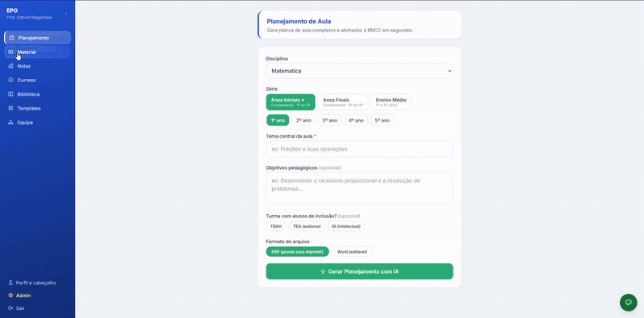
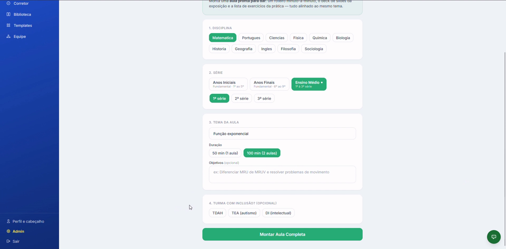
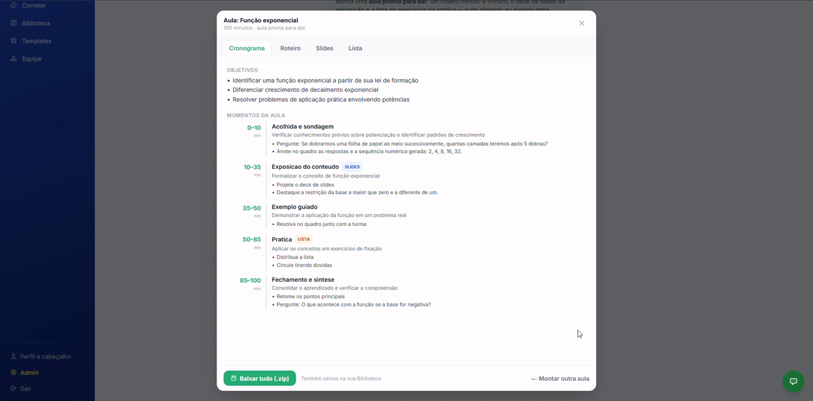
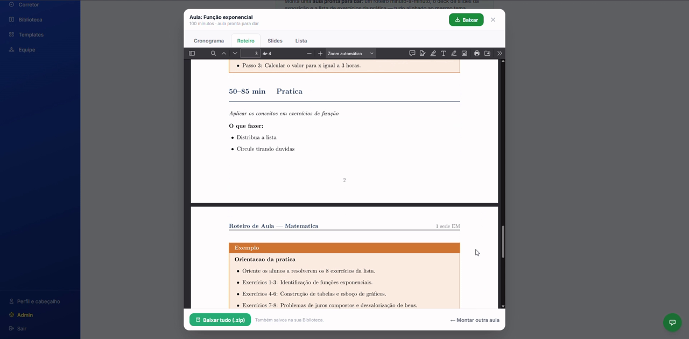
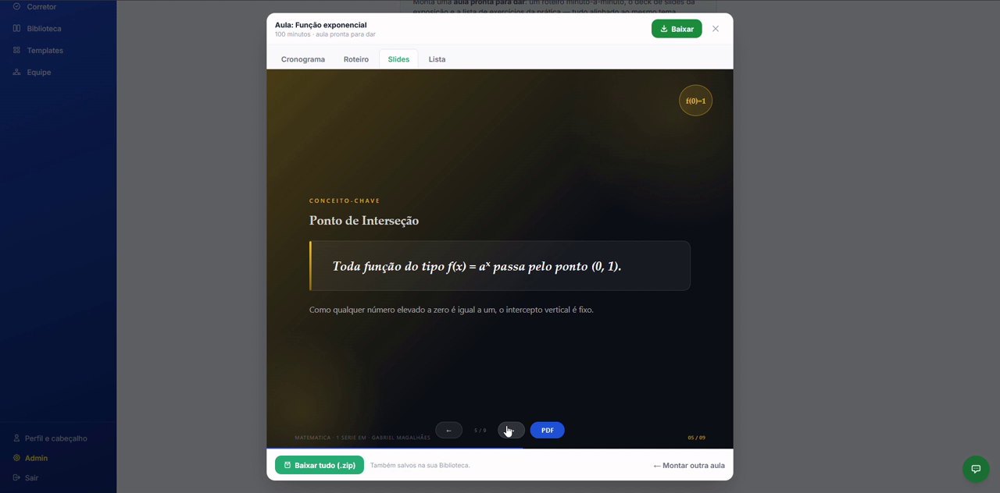
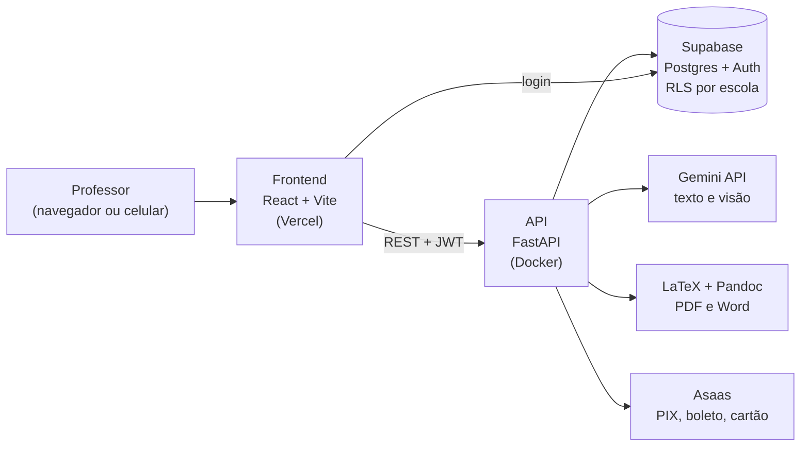

# Turmia: IA que monta a aula do professor

**🌐 [turmia.com.br](https://turmia.com.br)** · em produção desde julho/2026

O professor escolhe a disciplina, a série e o tema. Em cerca de um minuto, o Turmia entrega a aula pronta: roteiro minuto a minuto, slides, apostila em PDF e lista de exercícios, tudo sobre o mesmo tema e já com a identidade visual da escola.

> Este repositório é a **vitrine** do projeto. O código-fonte é privado, por ser um produto comercial. Fico feliz em mostrar e explicar o código numa entrevista.

---

## O problema

Sou professor de Matemática, Física e Química na educação básica. Toda semana eu perdia horas montando prova, apostila e slide, e as ferramentas de IA genéricas devolviam um texto que ainda precisava ser diagramado, revisado e adaptado. O professor brasileiro não precisa de mais um chat: precisa do **material pronto pra imprimir**.

## A solução

Mais de 15 ferramentas com IA, pensadas pra rotina da escola:

| | |
|---|---|
| 📚 **Aula completa** | Cronograma, roteiro, slides e lista de exercícios a partir de um tema |
| 📄 **Apostilas e provas** | PDF diagramado em LaTeX (capa, caixas de destaque, gabarito), com exportação em Word |
| 🎯 **Questões reais de vestibular** | Banco com questões do ENEM, FUVEST, UNICAMP, VUNESP, FGV, UFRGS e Mackenzie, com a fonte citada |
| ✍️ **Correção de redação** | Nota e feedback nas 5 competências do ENEM |
| 📸 **Correção por foto** | O professor fotografa o gabarito e as notas são lançadas |
| 🧩 **Inclusão** | Adapta o material pra alunos com TDAH, TEA ou DI |
| 🏫 **Identidade da escola** | Logo e cores da escola em todo material, com painel do coordenador pra gerir a equipe |
| 🗓️ **Plano de aula** | Alinhado à BNCC, com os códigos de habilidade |

**Público:** professores da educação básica (plano individual) e escolas (planos por número de professores, com gestão de equipe).

<table>
<tr>
<td></td>
<td></td>
</tr>
<tr>
<td></td>
<td></td>
</tr>
</table>

---

## Arquitetura

- **Frontend:** React 19 + Vite + Tailwind, com deploy na Vercel
- **Backend:** FastAPI organizado em routers por módulo (material, redação, corretor, notas, planejamento, financeiro...), com schemas Pydantic
- **Banco e autenticação:** Supabase. O frontend faz login e manda o JWT, e a API valida o token e consulta o banco *como o usuário*, então o RLS do Postgres se aplica a cada consulta
- **IA:** Gemini (`gemini-2.5-flash-lite`) pra texto e visão
- **Documentos:** LaTeX (pdflatex) pra PDF e Pandoc pra Word, rodando dentro do container
- **Qualidade:** testes com pytest e CI no GitHub Actions a cada PR

---

## Desafios técnicos

### 1. Dados de uma escola nunca vazam pra outra (RLS)
Várias escolas usam o mesmo banco. Em vez de confiar só no filtro feito no código, ativei **Row Level Security** no Postgres. A API repassa o JWT do professor pro Supabase, então `auth.uid()` vale em cada consulta e o próprio banco recusa linhas de outra escola. A *service key*, que ignora o RLS, fica restrita a rotas administrativas e ao controle de cota.

### 2. LaTeX gerado por IA quebra a compilação
O modelo devolve LaTeX com vícios: cercas de markdown, texto de conversa antes do `\documentclass`, `**negrito**` de markdown, imagens que não existem, `\ifmmode` inventado com chave sobrando, `\newpage` que gera página em branco. Escrevi uma **camada de limpeza** que corrige cada um desses padrões antes do `pdflatex`. Ela tem testes unitários, um pra cada vício. Também separei o preâmbulo num **template fixo**: a IA só escreve o corpo, o que reduziu muito as falhas de compilação.

### 3. Slides que funcionam sem internet
Muita sala de aula não tem internet estável. Os slides eram HTML com KaTeX e Chart.js via CDN. Reescrevi o gerador pra **não depender de nenhuma CDN**: as fórmulas são convertidas em Python pra HTML/unicode, e os gráficos viram SVG estático. O arquivo abre em qualquer computador, offline.

### 4. Correção por foto
O professor fotografa o gabarito ou o caderno de notas, o modelo de **visão** extrai as respostas num JSON estruturado, e o backend valida e confere antes de lançar no banco.

### 5. Migração de Streamlit pra React + FastAPI com o produto em uso
O MVP era um único `app.py` em Streamlit. Separei a lógica em `services/` (sem nenhuma dependência de UI), expus tudo numa API FastAPI e reconstruí o frontend em React, **um módulo por vez**, enquanto a escola continuava usando o sistema.

### 6. Custo e plano gratuito
Um plano gratuito com cota mensal, um trial de 14 dias e a contagem de uso feita no backend, sem confiar no cliente. A geração só desconta da cota **depois** de dar certo: se a IA falhar, o professor não perde crédito, e isso tem teste automatizado.

---

## Resultados

- **Em produção** em [turmia.com.br](https://turmia.com.br), com domínio próprio e cobrança recorrente (Asaas)
- **Piloto na escola onde dou aula**, em Santo Amaro/BA, com a identidade visual da escola nos materiais
- Projeto feito do zero por uma pessoa só: produto, código, deploy e as primeiras vendas

## Stack

`Python` `FastAPI` `Pydantic` `React` `Vite` `Tailwind` `PostgreSQL` `Supabase` `Gemini API` `LaTeX` `Docker` `pytest` `GitHub Actions` `Vercel`

---

**Gabriel Pereira** · [LinkedIn](https://www.linkedin.com/in/gabriel-magalhaes-pereira/) · gabiteclas@gmail.com · [outros projetos](https://github.com/gabikeys)
